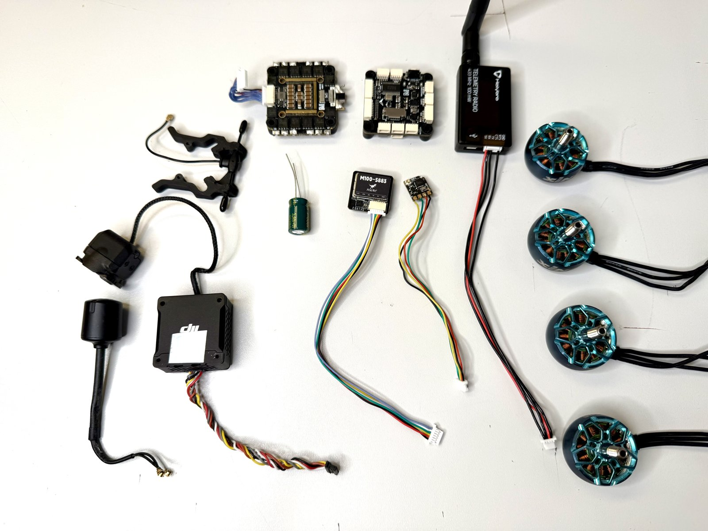
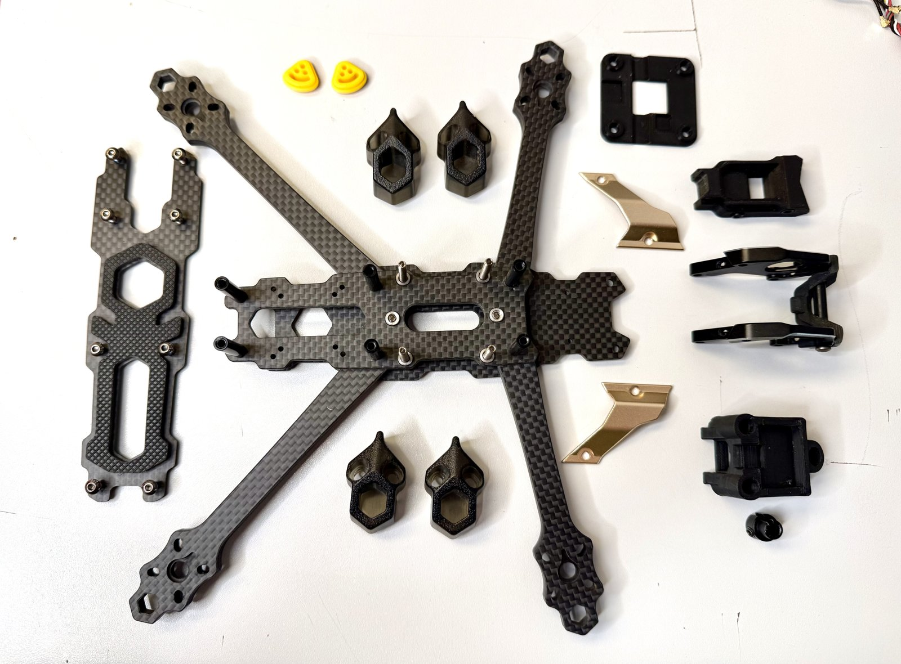
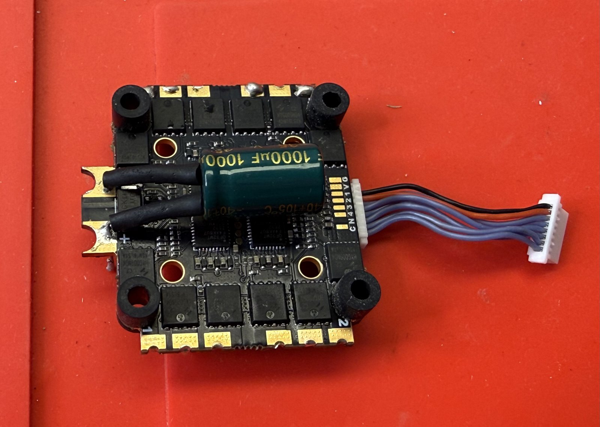
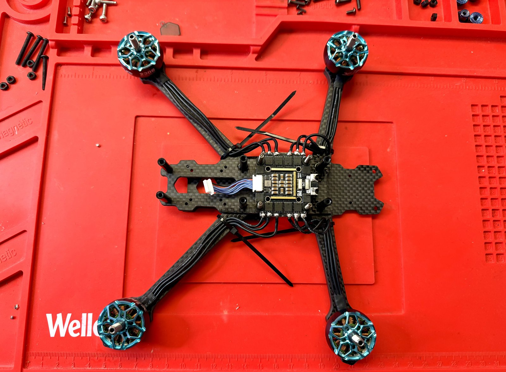
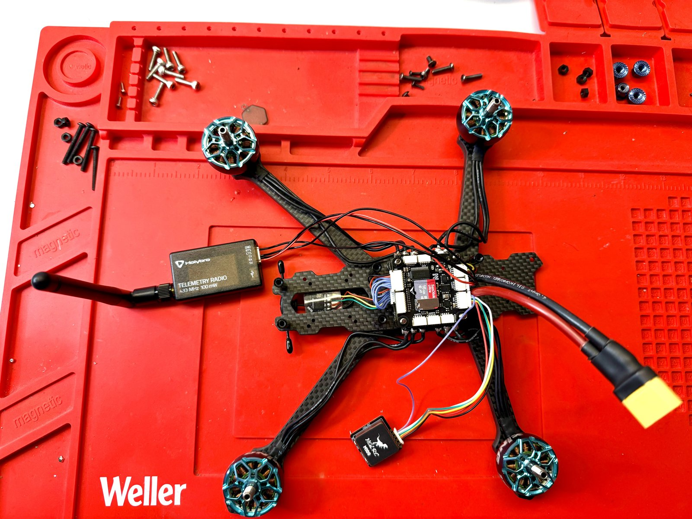
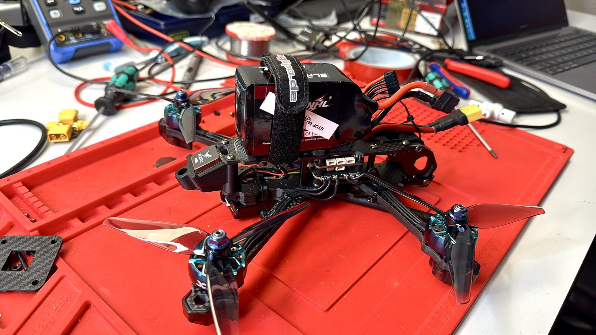

# Mario5 – Rebuild (2026-11-04 to 2026-11-06)

From a Betaflight FPV quad to PX4 with GNSS, compass and MAVLink telemetry.

| Component | Before | After |
|---|---|---|
| Flight controller | SpeedyBee F405 V4 | MicoAir H743 V2 |
| ESC | J-H-40, Bluejay | MicoAir 55 A, AM32 |
| GNSS / compass | GEP-M10, no compass | HGLRC M100-5883 |
| Telemetry | – | Holybro Telemetry Radio V3, MAVLink |
| RC | ExpressLRS | unchanged |
| Video | DJI O3 | removed |
| Firmware | Betaflight | PX4 1.17.0 |

## Photos

| | |
|---|---|
|  |  |
| New components | Frame stripped |
|  |  |
| ESC with 1000 µF capacitor | ESC and motors |
|  |  |
| FC, GNSS, telemetry | Assembled |

## Wiring

As per the [MicoAir743v2 documentation](https://micoair.com/flightcontroller_micoair743v2/).

| Device | Port | PX4 |
|---|---|---|
| Telemetry radio | TELEM1 (UART1) | `MAV_0_CONFIG` 101, 57600 baud |
| GNSS | GPS1 (UART3) | `GPS_1_CONFIG` 201 |
| Compass (in GNSS module) | I2C1 | active; onboard compass disabled |
| ELRS receiver | RC (UART6) | CRSF |
| ESC | ESC connector, outputs 1–4 | DShot, bidirectional |

## Issues during bring-up

- ESC did not respond: one bent pin in the ESC connector (used stack). Straightened.
- Telemetry link with very low throughput: TX/RX short in a self-crimped JST-SH connector. Found by measuring the contacts, re-crimped.

## First hover

2026-11-06, indoor, Stabilized. Arm, kill and mode switches checked. Stable hover, no noticeable oscillation.

Parameter set: [`params/01_pretune.params`](params/01_pretune.params)
