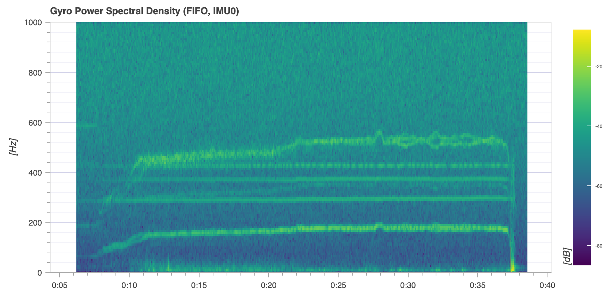
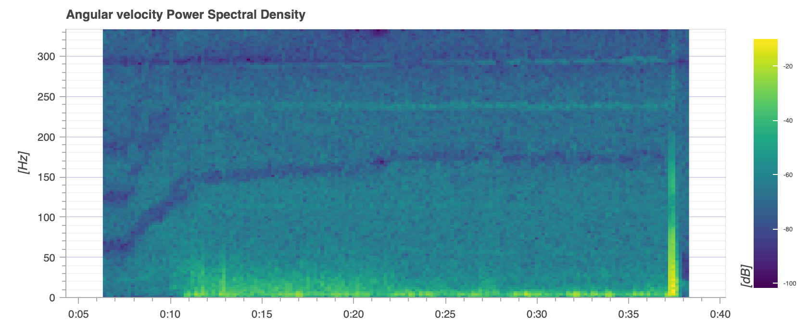

# Mario5 – Gyro filter (PX4 1.17)

5" quad, 3-blade props
Control rate: `IMU_GYRO_RATEMAX` 800

## Values

| Parameter | Start | Final |
|---|---|---|
| `IMU_GYRO_DNF_EN` | 0 | 1 (ESC RPM) |
| `IMU_GYRO_DNF_HMC` | 3 | 3 |
| `IMU_GYRO_DNF_BW` | 15 Hz | 15 Hz |
| `IMU_GYRO_DNF_MIN` | 25 Hz | 25 Hz |
| `IMU_GYRO_FFT_EN` | 1 | 0 |
| `IMU_GYRO_NF0_FRQ` / `_BW` | – | 292 Hz / 35 Hz |
| `IMU_GYRO_NF1_FRQ` / `_BW` | – | 370 Hz / 20 Hz |
| `IMU_GYRO_CUTOFF` | 80 Hz | 120 Hz |
| `IMU_DGYRO_CUTOFF` | 20 Hz | 50 Hz |

Full parameter set: [`params/03_filters.params`](params/03_filters.params)

## Spectra

Raw gyro (FIFO, before all filters):

RPM-dependent: motor fundamental (~150–180 Hz) and 3rd harmonic.
Fixed: resonances at ~290 Hz, ~370 Hz and ~430 Hz.

Filtered gyro (controller input, 667 Hz):

## Logging

`SDLOG_PROFILE` 273. The board's SD write rate is ~400 KiB/s. With `IMU_GYRO_RATEMAX` 800 the log produces ~340 KiB/s, dropouts below 1 %.

## Open

The ~290 Hz resonance shifts slightly with throttle (286–298 Hz measured in hover), so NF0 is set wide. To be checked again in outdoor flight under higher load and adjusted if needed.
