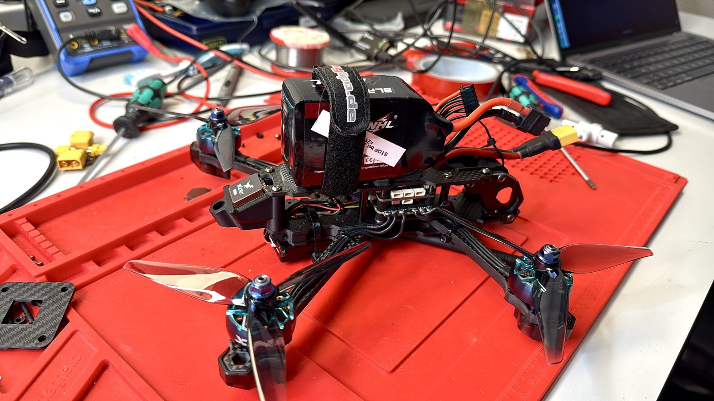

# uav-mario5-px4

5" quadcopter, rebuilt from Betaflight to PX4. Goal: a well-tuned, GNSS-capable platform that flies short autonomous missions, then optimising flight time with different propellers and a Li-Ion pack.

## Hardware

| Component | Part |
|---|---|
| Frame | 5" SpeedyBee Mario5 FPV frame |
| Motors | iFlight XING2 2306, 1855 KV |
| Flight controller | MicoAir H743 V2 |
| ESC | MicoAir 55 A, AM32, DShot300 bidirectional |
| GPS / compass | HGLRC M100-5883 |
| Telemetry | Holybro Telemetry Radio V3, 433 MHz, MAVLink |
| RC | ExpressLRS, 2.4 GHz |
| Battery | 6S 1300 mAh LiPo |
| Firmware | PX4 1.17.0, QGroundControl on macOS |

## Status

| Step | State |
|---|---|
| Rebuild and PX4 setup | done |
| First indoor hover | done, 2026-11-06 |
| Gyro filter setup | done, 2026-11-08 |
| First outdoor flight, PID tuning | next |
| Short autonomous mission | planned |
| Propeller comparison (3-blade vs. 2-blade) | planned |
| Li-Ion pack, flight time | planned |

## Contents

- [LOGBOOK.md](LOGBOOK.md): all relevant changes
- [BUILD.md](BUILD.md): rebuild, wiring, first hover
- [FILTER.md](FILTER.md): gyro filter setup with spectra
- [params/](params/): PX4 parameter sets, numbered as referenced in the logbook

## Licence

Code and parameter files: [MIT](LICENSE). Documentation, photos and plots: [CC BY 4.0](https://creativecommons.org/licenses/by/4.0/).
