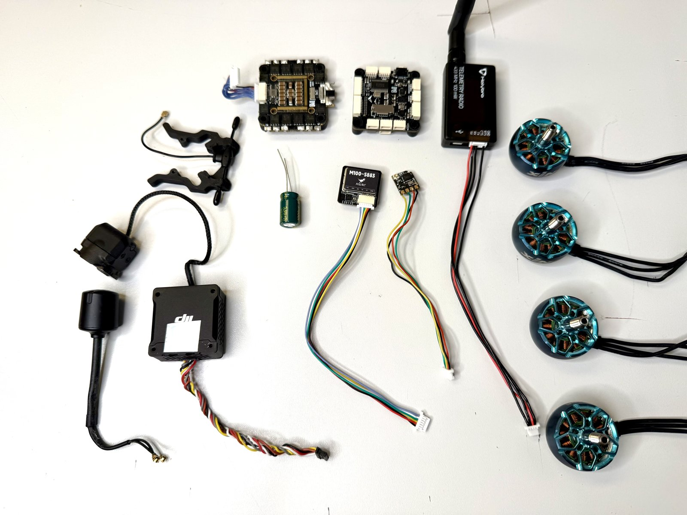
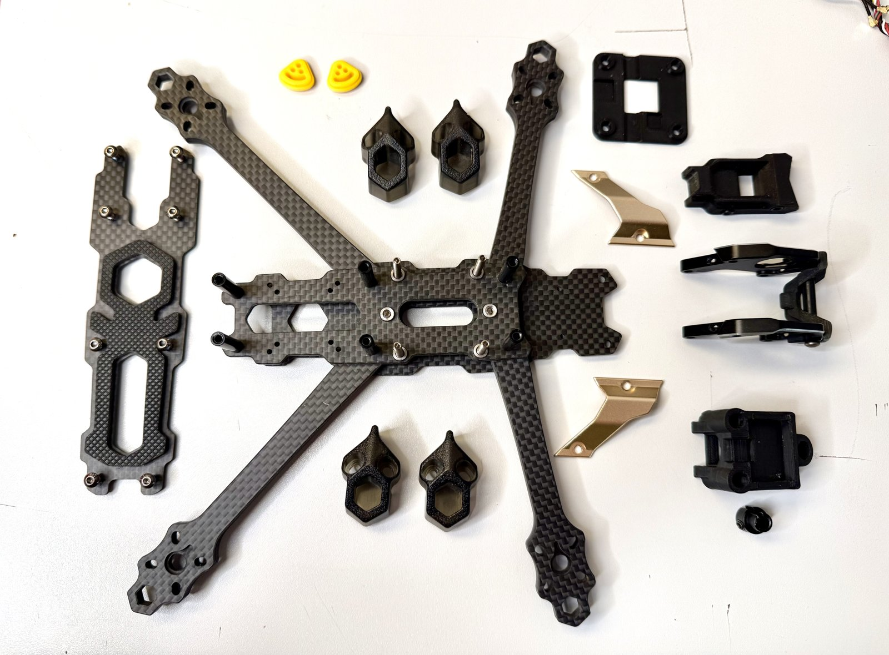
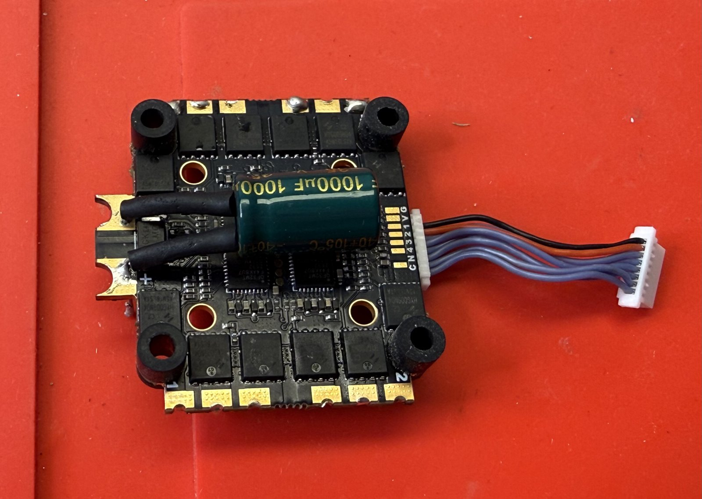
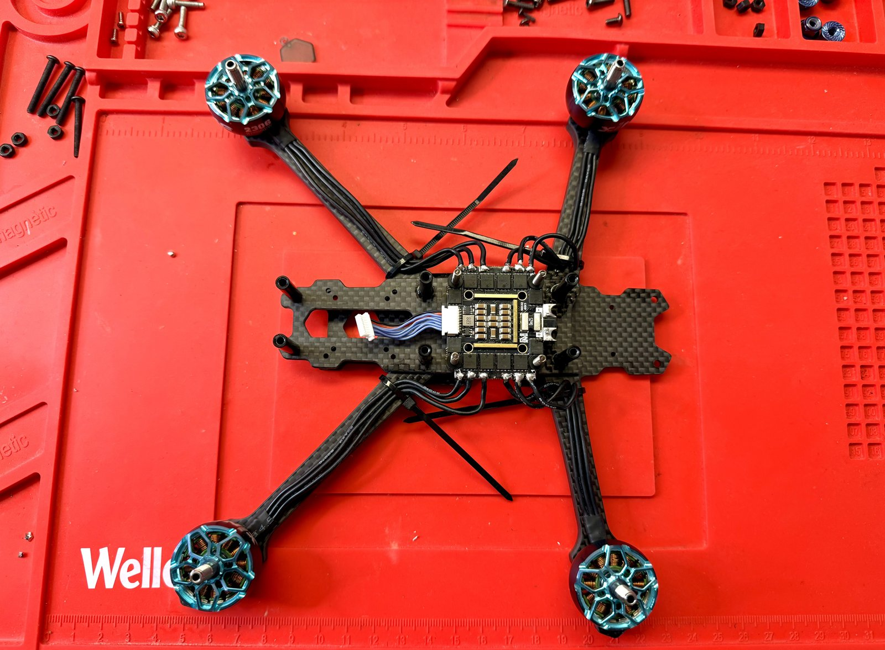
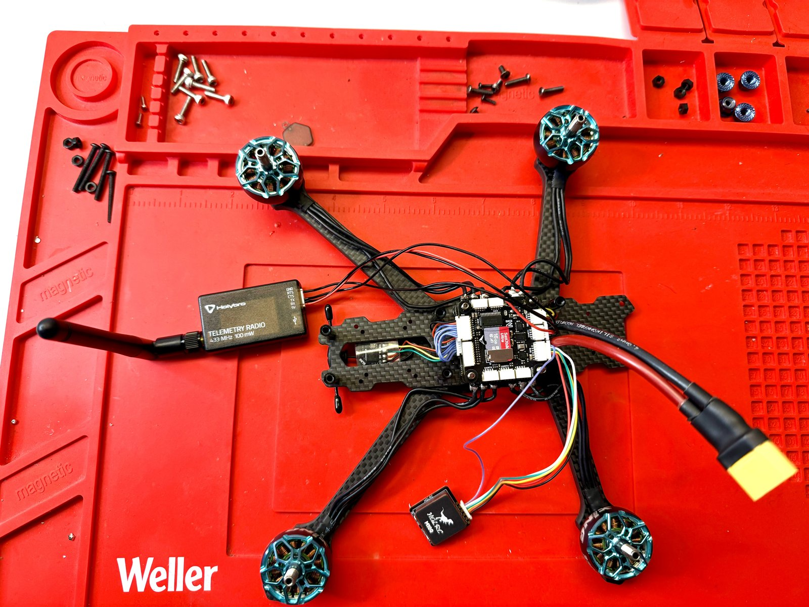
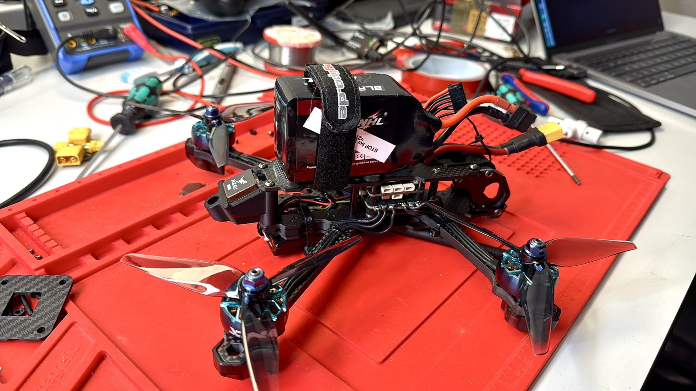

# 01: Migration from Betaflight to PX4

**Period:** 2026-11-04 to 2026-11-05
**Result:** aircraft rebuilt on a new flight stack, all systems working, first indoor hover successful

The aircraft started as a Betaflight FPV quad. For GNSS navigation, missions and MAVLink telemetry it was rebuilt on a flight controller with enough resources for a full autopilot and moved to PX4.

## Starting point: Betaflight

| Component | Part |
|---|---|
| Flight controller | SpeedyBee F405 V4 |
| ESC | 4-in-1, J-H-40, Bluejay 0.21.0, 48 kHz |
| Video | DJI O3 (DisplayPort OSD) |
| Receiver | ExpressLRS (CRSF) |
| GNSS | GEP-M10, no compass |
| Battery | 6S 1300 mAh |

Full configuration backup before the rebuild: [`params/legacy/2026-11-01_betaflight_speedybeef405v4_cli-dump.txt`](../../params/legacy/2026-11-01_betaflight_speedybeef405v4_cli-dump.txt)

## What changed

| Component | Before | After |
|---|---|---|
| Flight controller | SpeedyBee F405 V4 | MicoAir H743 V2 (onboard compass QMC5883L) |
| ESC | J-H-40, Bluejay | MicoAir 55 A, AM32, DShot600 bidirectional |
| GNSS / compass | GEP-M10, no compass | HGLRC M100-5883 (GNSS + QMC5883 compass) |
| Telemetry | not installed | Holybro Telemetry Radio V3 (433 MHz), MAVLink |
| Receiver | ExpressLRS | unchanged |
| Video | DJI O3 | removed for now |
| Firmware | Betaflight 2026.6.1 | PX4 1.17.0 |

## Build

| | |
|---|---|
|  |  |
| New components before assembly | Frame stripped down |
|  |  |
| ESC with 1000 µF capacitor on the battery pads | ESC mounted, motor leads soldered |
|  |  |
| FC stacked, GNSS and telemetry radio connected | Assembled, battery on top |

<!-- TODO (Yannik): notes on wiring and UART assignment, anything that went wrong during assembly -->

## Configuration in QGroundControl

1. Airframe: Generic Quadcopter (`SYS_AUTOSTART = 4001`)
2. Board orientation: yaw 180° (`SENS_BOARD_ROT = 4`)
3. Sensor calibration: gyro, accelerometer, two magnetometers, level horizon
4. Radio: CRSF (`RC_INPUT_PROTO = 6`), arm switch on channel 5, kill switch on channel 6, flight mode channel 8 (Stabilized / Altitude / Position)
5. Actuators: motor order and direction checked, DShot600 bidirectional, 14 poles
6. Power: 6S, 1300 mAh
7. Telemetry radio on MAVLink, failsafe on RC loss: Return

<!-- TODO (Yannik): problems during PX4 setup and how they were solved -->

## First hover

<!-- TODO (Yannik): date, indoor location type, flight mode, duration, observations -->

Parameter set: [`params/2026-11-05_01_baseline-pre-tune.params`](../../params/2026-11-05_01_baseline-pre-tune.params)

## Open points

- Telemetry radio: reduce TX power to the EU limit for 433 MHz SRD (10 mW ERP); the module ships with 100 mW
- Centre of gravity: check battery position
- Barometer: cover with open-cell foam against prop wash
- Hover throttle: high thrust-to-weight ratio expected, check `MPC_THR_HOVER` against the learned value after the first flights
- RPM-based dynamic notch filter (`IMU_GYRO_DNF_EN`), ESC RPM telemetry is available
- Autotune
